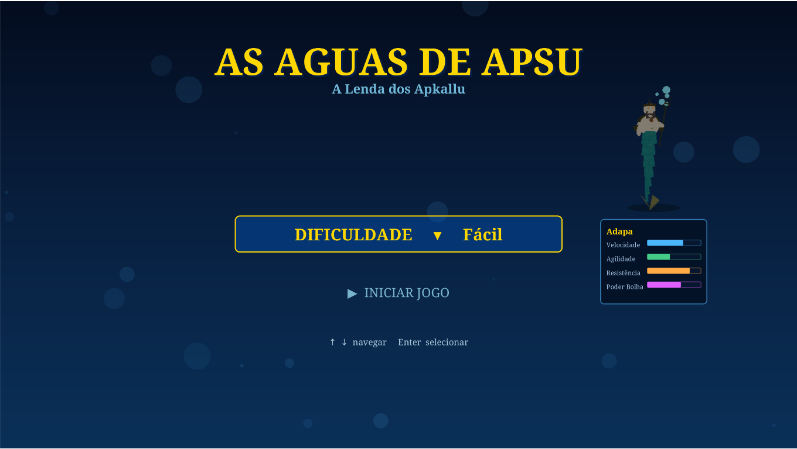
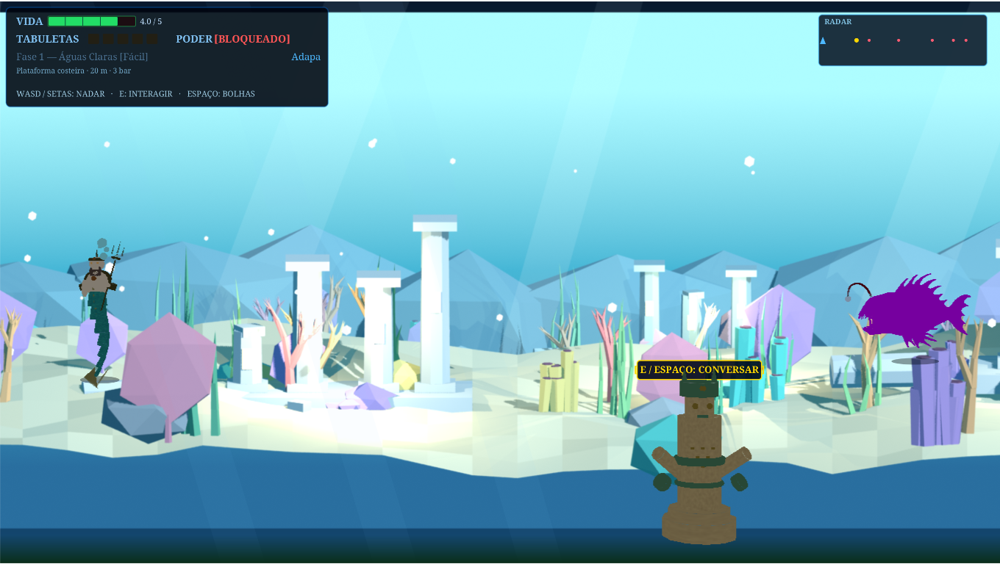
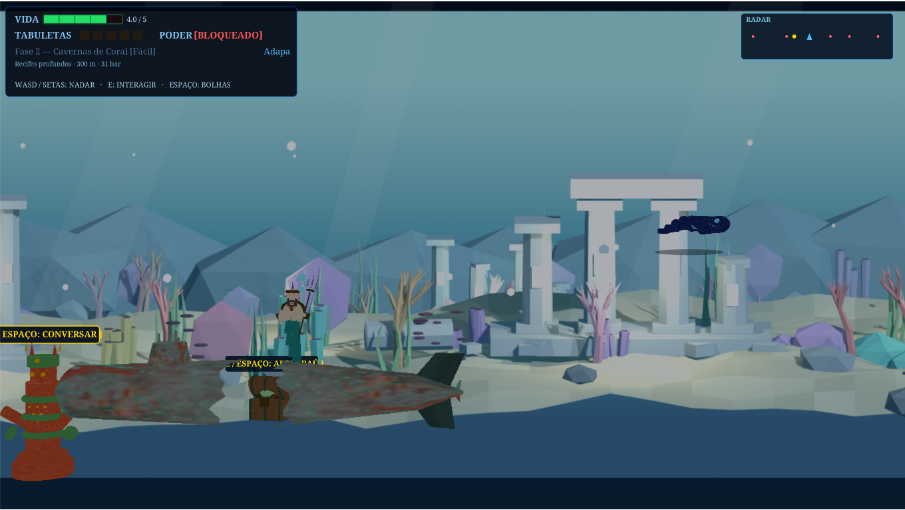
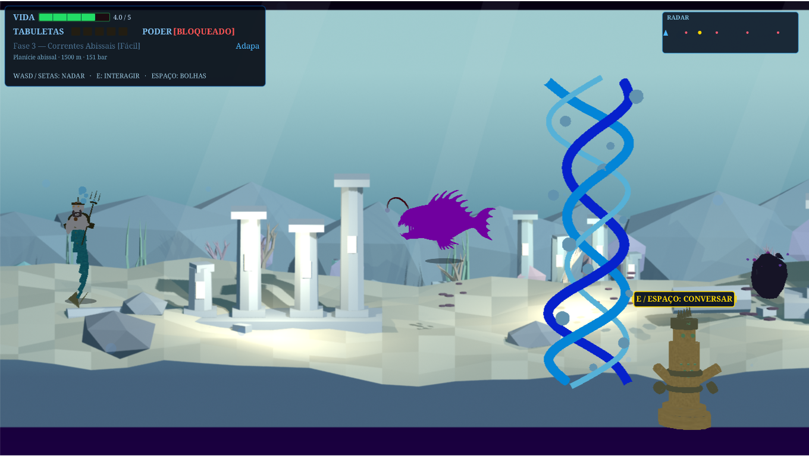
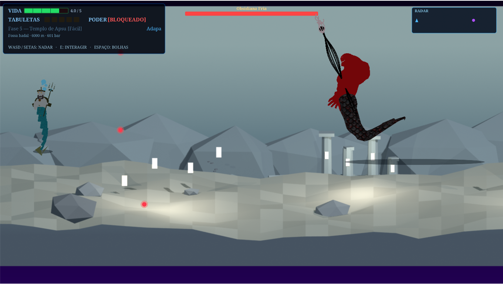
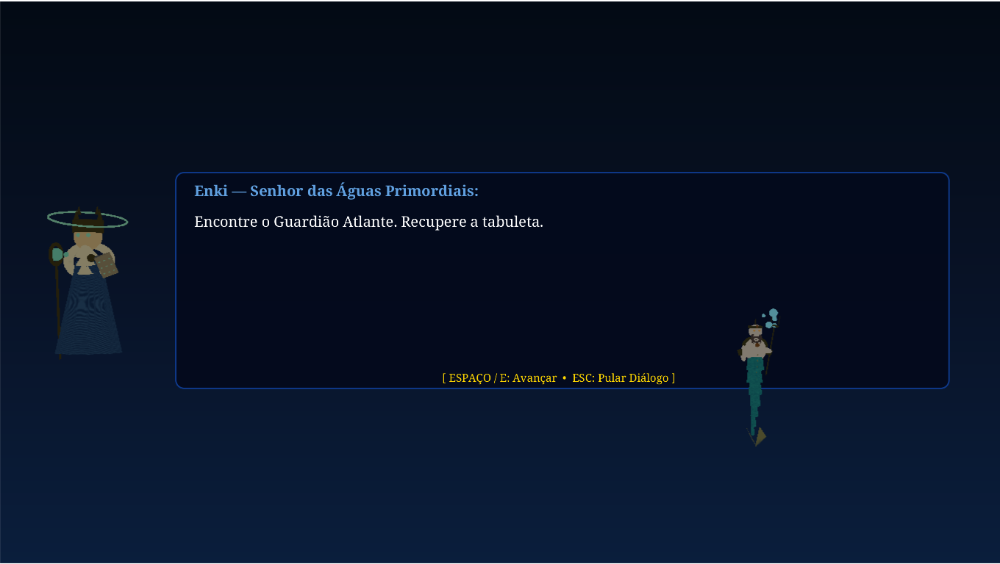
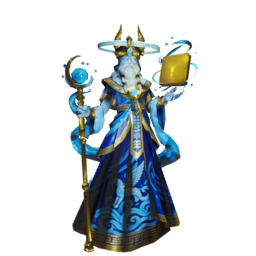
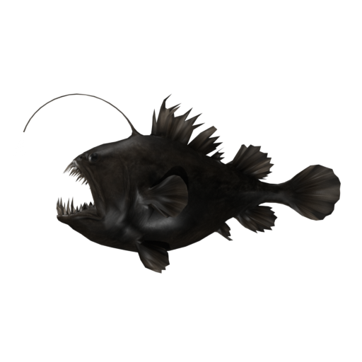

# As Águas de Apsu

> Jogo de ação e aventura subaquática 2.5D retro arcade — Java 21 + JavaFX

Mergulhe nas profundezas do oceano primordial da mitologia suméria. Controle **Adapa**, o sábio pescador amaldiçoado, pelas águas de Apsu enquanto enfrenta monstros abissais, recupera tabuletas sagradas e desperta poderes ancestrais — até o duelo final contra o temível **Kullullu** no Templo das Profundezas.

---

## Capturas de Tela

<table>
  <tr>
    <td align="center"><br/><sub>Menu Principal</sub></td>
    <td align="center"><br/><sub>Fase 1 — Águas Claras</sub></td>
  </tr>
  <tr>
    <td align="center"><br/><sub>Fase 2 — Cavernas de Coral</sub></td>
    <td align="center"><br/><sub>Fase 3 — Correntes Abissais</sub></td>
  </tr>
  <tr>
    <td align="center"><br/><sub>Fase 5 — Templo de Apsu (Boss)</sub></td>
    <td align="center"><br/><sub>Diálogo com Enki</sub></td>
  </tr>
</table>

---

## Como Jogar

### Instaladores Prontos

Baixe e instale diretamente — sem dependências extras:

| Plataforma | Formato |
|---|---|
| Linux | `.deb` |
| macOS | `.dmg` |
| Windows 10/11 | `.exe` |

👉 **[Releases no GitHub](https://github.com/passosdomingues/apsu-game/releases)**

### Compilar do Código-Fonte

Requer **Java 21+** e **Maven 3.9+** (ou `make`):

```bash
# Via Make (recomendado)
make run

# Via Maven
mvn javafx:run
```

---

## Controles

| Ação | Teclas |
|---|---|
| Nadar | `W A S D` ou setas |
| Disparar bolhas / Interagir | `Espaço` ou `E` |
| Ecolocalização | `Q` ou `Shift` esquerdo |
| Pausa / Menu | `ESC` |

> O disparo de bolhas é desbloqueado ao interagir com o baú na **Fase 2**.

---

## As Cinco Fases

| # | Região | Desafio |
|---|---|---|
| 1 | **Águas Claras** | Introdução ao nado e esquiva; primeiro encontro com o Guardião Atlante |
| 2 | **Cavernas de Coral** | Galeão naufragado e o baú ancestral — desperta o poder das bolhas |
| 3 | **Correntes Abissais** | Correntes submarinas e zonas de pressão alteram a flutuabilidade |
| 4 | **Abismo Vulcânico** | Chaminés hidrotermais e confronto com a Leviatã Menor |
| 5 | **Templo de Apsu** | Duelo final contra Kullullu, lorde das profundezas |

---

## Personagens

<table>
  <tr>
    <td align="center"><br/><b>Adapa</b><br/><sub>Herói</sub></td>
    <td align="center"><br/><b>Kullullu</b><br/><sub>Boss Final</sub></td>
    <td align="center"><br/><b>Enki</b><br/><sub>NPC Guia</sub></td>
  </tr>
  <tr>
    <td align="center"><br/><sub>Peixe Sombrio</sub></td>
    <td align="center"><br/><sub>Medusa Elétrica</sub></td>
    <td align="center"><br/><sub>Leviatã Menor</sub></td>
  </tr>
</table>

---

## Stack Técnica

| Camada | Tecnologia |
|---|---|
| Linguagem | Java 21 (LTS) |
| UI / Gráficos | JavaFX 21 — Canvas 2D + SubScene 3D |
| Modelos 3D | Blender 4.5 → OBJ/MTL exportados via scripts `bpy` |
| Build | Apache Maven 3.9 + GNU Make |
| Testes | JUnit 5 — 197 testes, 100% aprovados |
| CI/CD | GitHub Actions — build, testes e release automáticos |
| Containerização | Docker (imagem de desenvolvimento) |
| Áudio | JavaFX MediaPlayer + trilha original FLAC/MP3 |

**Destaques da engine:**
- Renderização híbrida 2D/3D com degradê automático de qualidade (zero-alloc a 60 FPS)
- Sistema de ecolocalização: ondas de pulso acústico revelam o ambiente no escuro
- Bioluminescência dinâmica sincronizada com a mecânica de flutuabilidade

---

## Equipe

| Área | Responsável |
|---|---|
| ⚙️ Mecânica, Física e Engine | **Rafael** (`@passosdomingues`) |
| 🎵 Trilha Sonora e Composição Musical | **Erik Alexandre** |
| 🧊 Modelos 3D dos Personagens | **Wagner** |
| 🌊 Modelos 3D e Arte dos Cenários | **Marcos** |

Revisão de código por área definida em [CODEOWNERS](CODEOWNERS).

---

## Documentação

Documentação técnica completa disponível em [`docs/`](docs/):

- [Arquitetura e Desenvolvimento](docs/ARQUITETURA_E_DESENVOLVIMENTO.md)
- [Pipeline 3D](docs/PIPELINE_3D.md)
- [Guia de Contribuição](docs/CONTRIBUTING.md)
- [Guia de Desenvolvimento](docs/DEVELOPMENT.md)

---

## Licença

Distribuído sob a licença **Apache 2.0** — consulte [LICENSE](LICENSE).
