# As Águas de Apsu

> Jogo de ação e aventura subaquática 2.5D retro arcade — Java 21 + JavaFX

[-0078D6?style=for-the-badge&logo=windows&logoColor=white)](https://github.com/passosdomingues/apsu-game/releases/latest)
[](https://github.com/passosdomingues/apsu-game/releases/latest)
[](https://github.com/passosdomingues/apsu-game/releases/latest)
[](https://github.com/passosdomingues/apsu-game/releases/tag/v20261125-213629)

---

## 🎮 DOWNLOAD EM DESTAQUE (INSTALADOR EXECUTÁVEL)

<div align="center">

# 🪟 [⬇️ CLIQUE AQUI PARA BAIXAR O INSTALADOR WINDOWS (.EXE)](https://github.com/passosdomingues/apsu-game/releases/latest)

### **Instalador Oficial para Windows 10 e Windows 11 (64-bit)**
> **Pronto para jogar:** não requer instalação de Java nem configuração de variáveis de ambiente.  
> O **Java 21 LTS** e todos os módulos gráficos e sonoros já vêm **100% embutidos** no executável `.exe`.

| Plataforma | Pacote / Formato | Ação de Instalação |
|---|---|---|
| **Windows 10 / 11 (64-bit)** | **`.exe` (Instalador Nativo)** | **[👉 Baixar Executável (.exe)](https://github.com/passosdomingues/apsu-game/releases/latest)** |
| **Linux (Ubuntu / Debian x64)** | `.deb` (Pacote Debian) | [👉 Baixar Pacote (.deb)](https://github.com/passosdomingues/apsu-game/releases/latest) |
| **macOS (Apple Silicon & Intel)** | `.dmg` (Imagem de Disco) | [👉 Baixar Imagem (.dmg)](https://github.com/passosdomingues/apsu-game/releases/latest) |

</div>

---

Mergulhe nas profundezas do oceano primordial da mitologia suméria. Controle **Adapa**, o sábio pescador amaldiçoado, pelas águas de Apsu enquanto enfrenta monstros abissais, recupera tabuletas sagradas e desperta poderes ancestrais — até o duelo final contra o temível **Kullullu** no Templo das Profundezas.

---

## Capturas de Tela do Jogo

<table>
  <tr>
    <td align="center">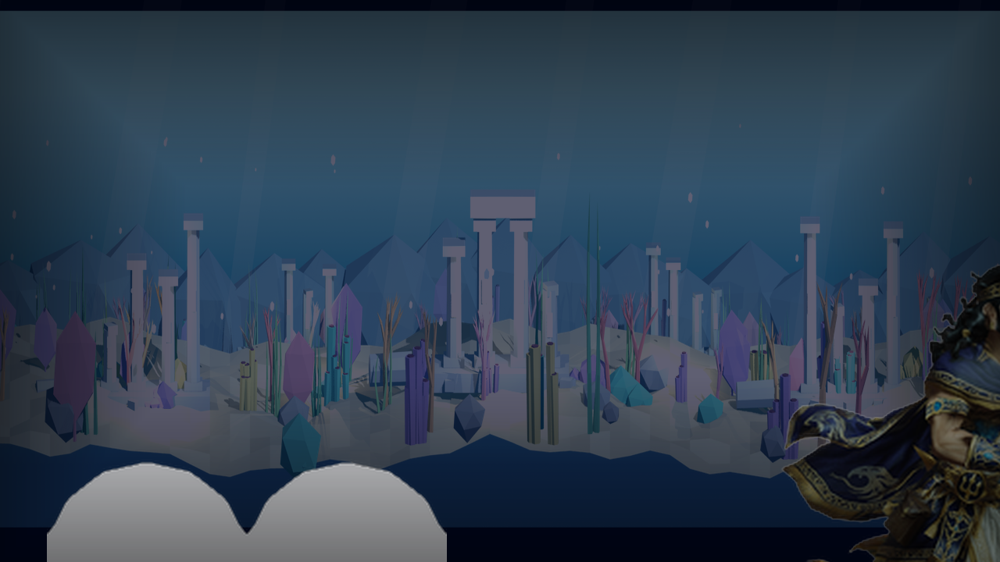<br/><sub>Menu Principal — Adapa &amp; Enki</sub></td>
    <td align="center">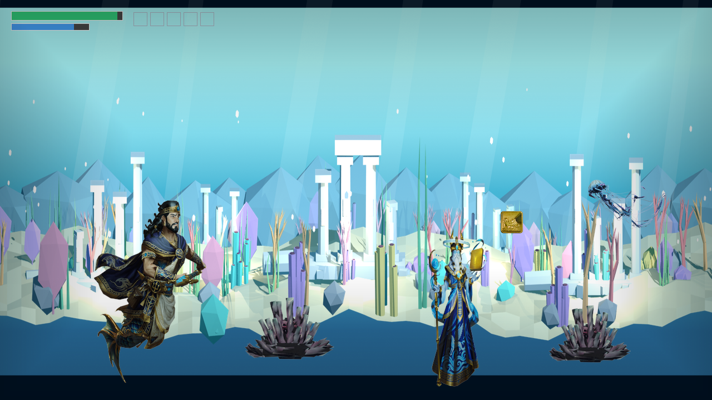<br/><sub>Fase 1 — Águas Claras: Enki Guardião, Tabuleta 3D &amp; Corais</sub></td>
  </tr>
  <tr>
    <td align="center">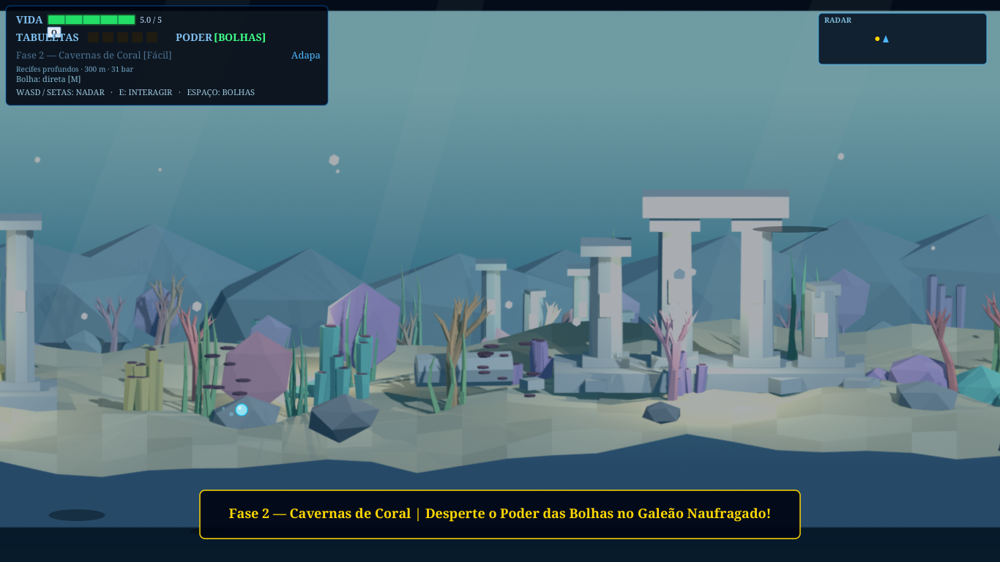<br/><sub>Fase 2 — Cavernas de Coral: Navio Naufragado, Baú &amp; Bolhas 3D</sub></td>
    <td align="center">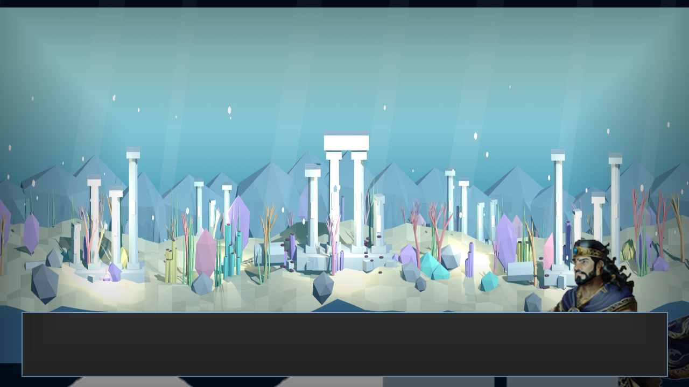<br/><sub>Fase 2 — Diálogo in-game com Enki Celestial &amp; Tabuleta Sagrada</sub></td>
  </tr>
  <tr>
    <td align="center">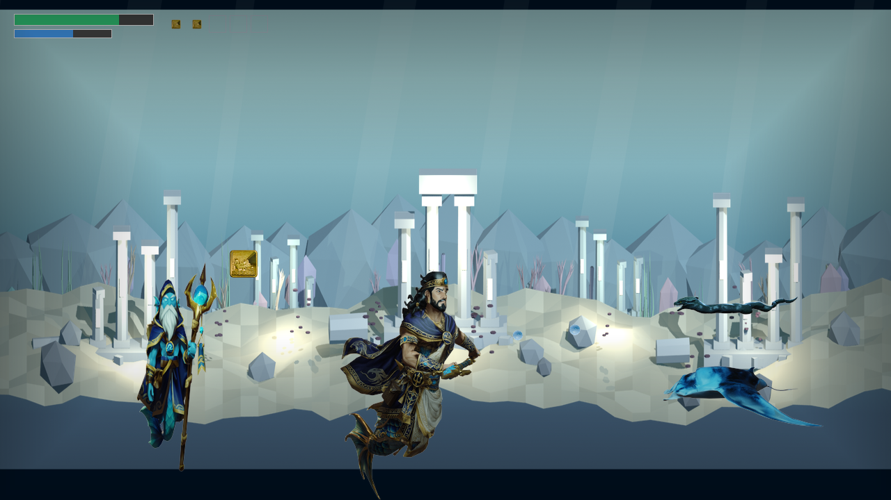<br/><sub>Fase 3 — Correntes Abissais: Enki Eremita, Tabuleta 3D &amp; Enguia</sub></td>
    <td align="center">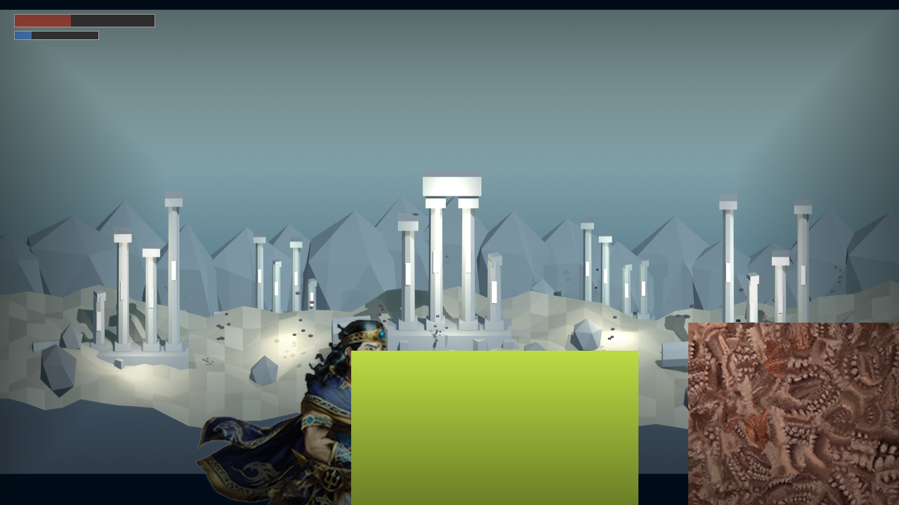<br/><sub>Fase 4 — Abismo Vulcânico: Portal Ativado 3D &amp; Magma</sub></td>
  </tr>
  <tr>
    <td align="center" colspan="2">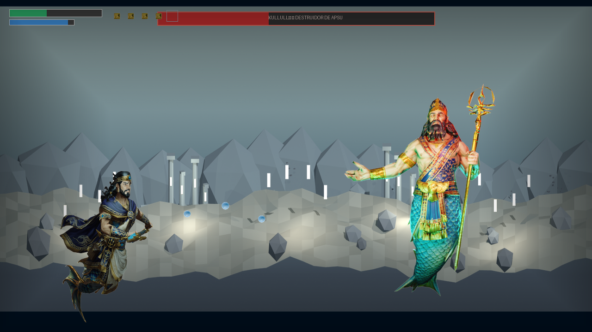<br/><sub>Fase 5 — Templo de Apsu: Duelo Final contra Boss Kullullû com Disparo de Bolhas 3D</sub></td>
  </tr>
</table>

### Adapa — Herói Atualizado (render 3D)

<div align="center">
  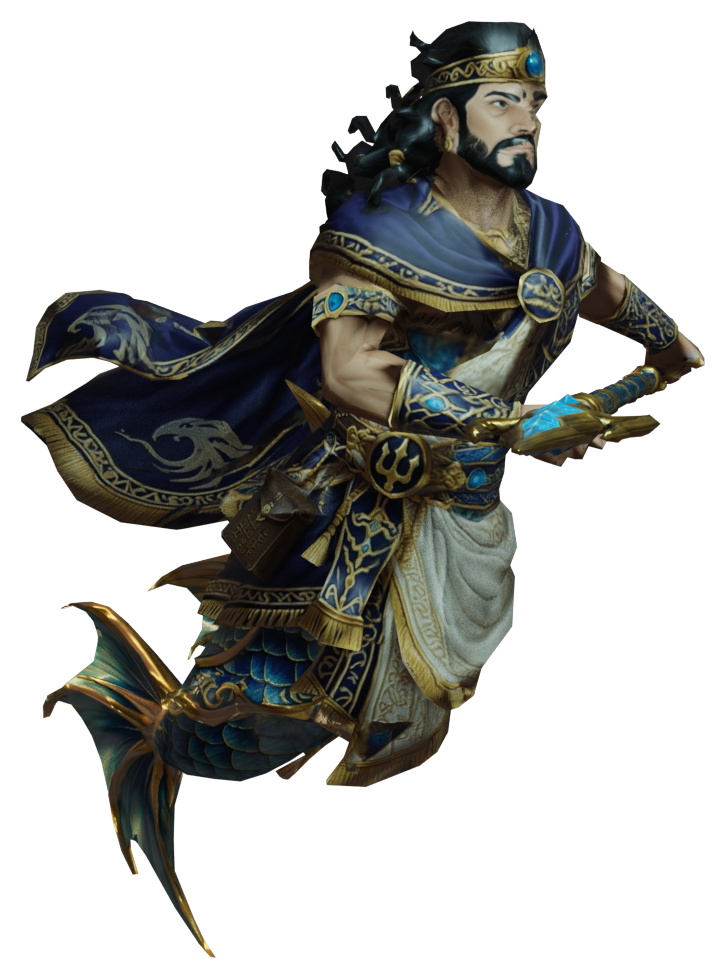
  <br/><sub>Adapa, o Apkallu — modelagem 3D por Wagner Donizete Gonçalves</sub>
</div>

---

## ⚡ Início Rápido (Como Rodar Rapidamente)

### 📥 Download Imediato (Instaladores Prontos)

Baixe e jogue diretamente — o Java 21 já vem embutido em todos os pacotes:

| Sistema Operacional | Formato do Instalador | Link de Download Direto |
|---|---|---|
| **Windows 10 / 11 (64-bit)** | `.exe` (Instalador Nativo) | [⬇️ Baixar Instalador Windows (.exe)](https://github.com/passosdomingues/apsu-game/releases/latest) |
| **Linux (Ubuntu / Debian x64)** | `.deb` (Pacote Debian) | [⬇️ Baixar Pacote Linux (.deb)](https://github.com/passosdomingues/apsu-game/releases/latest) |
| **macOS Apple Silicon (M1–M4)** | `.dmg` | [⬇️ Baixar para macOS Apple Silicon](https://github.com/passosdomingues/apsu-game/releases/latest) |
| **macOS Intel** | `.dmg` | [⬇️ Baixar para macOS Intel](https://github.com/passosdomingues/apsu-game/releases/latest) |

👉 **[Todas as Versões e Releases no GitHub](https://github.com/passosdomingues/apsu-game/releases)**

---

### 💻 Executar a partir do Código-Fonte

Clone e execute em um único comando no terminal:

```bash
git clone https://github.com/passosdomingues/apsu-game.git
cd apsu-game
make
```

*(Requer Java 21+ e Maven 3.9+. Caso prefira rodar diretamente via Maven: `mvn javafx:run`)*

---

## 🖥️ Requisitos de Sistema

| Componente | Requisitos Mínimos (Modo 2D Fallback) | Requisitos Recomendados (Modo Híbrido 2.5D / 3D 60 FPS) | Requisitos Desejáveis (Hardware de Referência Testado — Lab B207) |
|---|---|---|---|
| **Sistema Operacional** | Windows 10 (64-bit), Ubuntu 20.04+, macOS 12+ | Windows 10/11 (64-bit), Ubuntu 22.04+, macOS 13+ | **Ubuntu 26.04.1 LTS (Kernel 7.0 / Wayland 64-bit) ou Windows 11 (64-bit)** |
| **Modelo de Referência** | Desktop padrão / Notebook comum | Desktop intermediário | **Daten Tecnologia Ltda DC5A-S (BIOS/Firmware A15)** |
| **Processador (CPU)** | Intel Core i3 (4ª geração) / AMD FX-6300 (2 núcleos, 2.0 GHz) | Intel Core i5 (8ª geração) / AMD Ryzen 5 (4+ núcleos) | **AMD Ryzen™ 7 5700 × 16 threads (3.7 GHz base, 4.6 GHz turbo)** |
| **Memória RAM** | 4 GB | 8 GB a 16 GB | **32,0 GiB RAM (Dual Channel DDR4)** |
| **Placa de Vídeo (GPU)** | Intel HD Graphics 4000 / Mesa OpenGL 2.1 | Intel Iris Xe / AMD Radeon RX 550+ | **NVIDIA GeForce GTX 750 Ti (Aceleração OpenGL 4.6 / D3D / Vulkan)** |
| **Armazenamento** | 250 MB livres | 500 MB livres (SSD recomendado) | **SSD 512,1 GB NVMe (leitura ultra-rápida de modelos 3D)** |
| **Resolução & FPS** | 1280 × 720 (janela @ 30-50 FPS) | 1366 × 768 (tela cheia @ 60 FPS) | **1920 × 1080 / 1366 × 768 (Tela Cheia @ 60 FPS cravados VSync)** |

---

## Controles

| Ação | Teclas |
|---|---|
| **Nadar / Mover-se** | `W A S D` ou Teclas de Direção `↑ ← ↓ →` |
| **Atacar (Purificar com Bolhas)** | `Espaço` (desbloqueado na Fase 2 no navio naufragado) |
| **Interagir (Diálogos e Baús)** | `E` ou `Espaço` |
| **Alternar Ataque (Único / Rajada Tripla)** | `M` |
| **Ecolocalização (Sonar Acústico)** | `Q` ou `Shift` esquerdo |
| **Pausar o Jogo / Menu de Pausa** | `ESC` ou `P` |
| **Reiniciar Fase Instantaneamente** | `R` (reinício rápido sem congelamentos) |

> O disparo de bolhas é desbloqueado ao interagir com o baú ancestral na **Fase 2**.

---

## As Cinco Fases

| # | Região | Desafio |
|---|---|---|
| 1 | **Águas Claras** | Introdução ao nado e esquiva; primeiro encontro com **Enki, o Sábio das Águas** |
| 2 | **Cavernas de Coral** | Galeão naufragado e o baú ancestral — desperta o poder das bolhas |
| 3 | **Correntes Abissais** | Correntes submarinas e zonas de pressão alteram a flutuabilidade |
| 4 | **Abismo Vulcânico** | Chaminés hidrotermais e confronto com o Leviatã Menor |
| 5 | **Templo de Apsu** | Duelo final contra Kullullu, lorde das profundezas |

---

## Personagens (Renders 3D Blender)

**Herói e Aliados**

<table>
  <tr>
    <td align="center">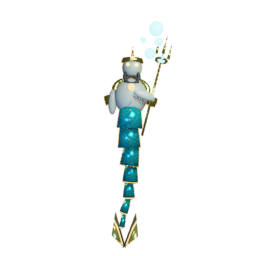<br/><b>Adapa</b><br/><sub>Herói</sub></td>
    <td align="center"><br/><b>Enki</b><br/><sub>Deus Guia</sub></td>
    <td align="center">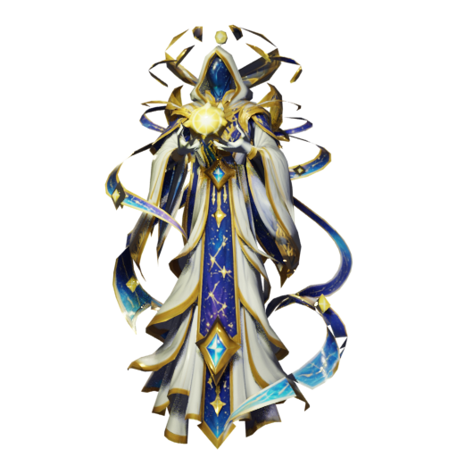<br/><b>Enki Celestial</b><br/><sub>Guardião</sub></td>
    <td align="center">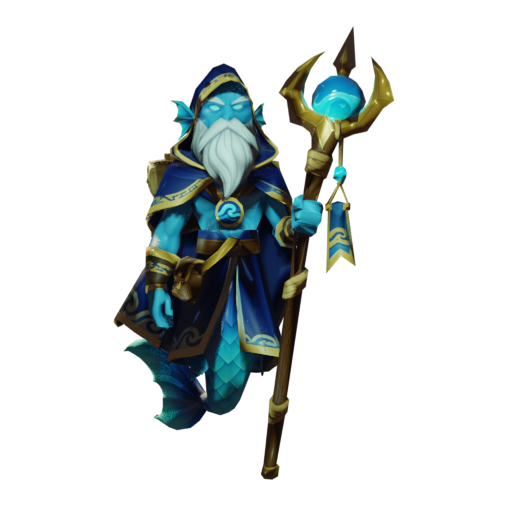<br/><b>Enki Eremita</b><br/><sub>Guardião</sub></td>
  </tr>
</table>

**Inimigos e Chefes**

<table>
  <tr>
    <td align="center">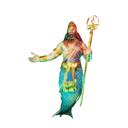<br/><b>Kullullu</b><br/><sub>Boss Final</sub></td>
    <td align="center">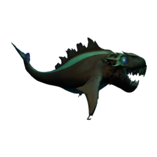<br/><b>Leviatã Menor</b><br/><sub>Sub-chefe</sub></td>
    <td align="center"><br/><b>Peixe Sombrio</b><br/><sub>Inimigo</sub></td>
    <td align="center"><br/><b>Medusa Elétrica</b><br/><sub>Inimigo</sub></td>
    <td align="center">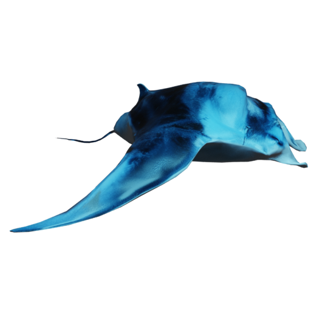<br/><b>Arraião Abissal</b><br/><sub>Inimigo</sub></td>
  </tr>
</table>

**Elementos de Cenário 3D**

<table>
  <tr>
    <td align="center">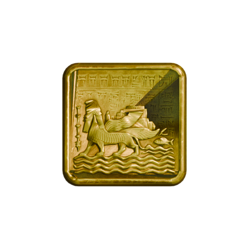<br/><b>Tabuleta Sagrada</b><br/><sub>Coleta — flutua com rotação 3D</sub></td>
    <td align="center">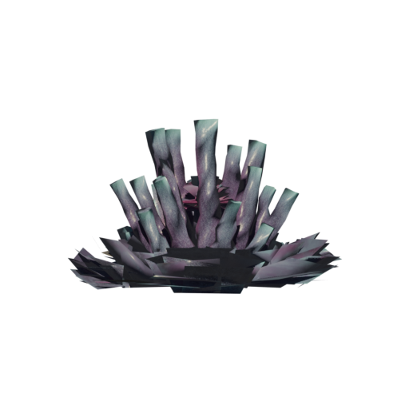<br/><b>Corais</b><br/><sub>Obstáculo — Fase 2</sub></td>
    <td align="center">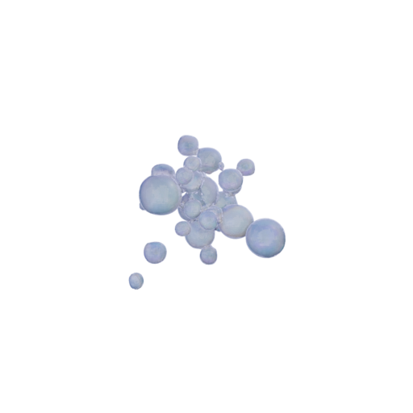<br/><b>Bolhas</b><br/><sub>Projétil 3D do Adapa</sub></td>
    <td align="center">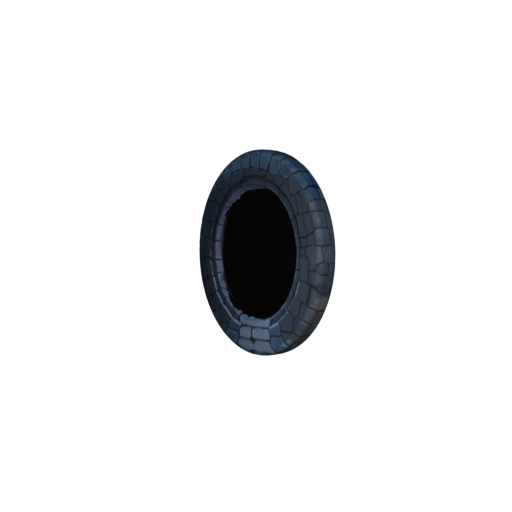<br/><b>Portal de Fase</b><br/><sub>Saída para próxima fase</sub></td>
  </tr>
</table>

---

## Stack Técnica

| Camada | Tecnologia |
|---|---|
| Linguagem | Java 21 (LTS) |
| UI / Gráficos | JavaFX 21 — Canvas 2D + SubScene 3D |
| Modelos 3D | Blender 4.5.5 LTS → OBJ/MTL via pipeline de scripts `bpy` |
| Build | Apache Maven 3.9 + GNU Make |
| Testes | JUnit 5 — 221 testes automatizados, 100% aprovados |
| CI/CD | GitHub Actions — build, testes com xvfb e release automáticos |
| Containerização | Docker (ambiente de desenvolvimento) |
| Áudio | JavaFX MediaPlayer + trilha original FLAC/MP3 |

**Destaques da engine:**
- Renderização híbrida 2D/3D com degradê automático de qualidade (zero-alloc a 60 FPS)
- Sistema de ecolocalização: ondas de pulso acústico revelam segredos no escuro
- Bioluminescência dinâmica sincronizada com a mecânica de flutuabilidade

---

## Equipe e Contribuições

| Integrante | Papel | Contribuições Principais |
|---|---|---|
| ⚙️ **Rafael Passos Domingues** (`@passosdomingues`) | **Product Owner** · Engine Lead | Mecânica de jogo, simulação física de fluidos, arquitetura do motor JavaFX, pipeline gráfico híbrido 2.5D/3D, otimizações zero-allocation e automação CI/CD multiplataforma |
| 🌊 **Marcos Felipe dos Reis Bento** | **Scrum Master** · Cenógrafo 3D | Modelagem procedural dos cenários 3D das 5 fases no Blender, progressão visual profundidade-escuridão por nível do mar, arte dos fundos multicamada e easter eggs (Boto, Golfinho) |
| 🛠️ **Carlos Eduardo Pereira dos Santos** | **Quality Assurance** | Verificação de requisitos de jogabilidade, cobertura de testes, garantia de qualidade e integração de sistemas |
| 🧊 **Wagner Donizete Gonçalves** | Modelador 3D | Modelagem geométrica de todos os personagens: Adapa, chefe Kullullû, Enki, criaturas marinhas, inimigos e guardiões (Blender → OBJ/MTL) |
| 🎵 **Érik Alexandre Vieira Peres** | Compositor | Trilha sonora original, paisagens sonoras subaquáticas adaptativas por fase e efeitos de áudio 3D |
| 📜 **Cawe dos Reis Barbosa Domiciano** | Narrativo · Designer de Fases | Pesquisa mitológica mesopotâmica (Apkallu/Apsu), inspiração e paleta de profundidade de cada fase (cada nível do mar mais escuro), conceito dos easter eggs Boto e Golfinho e modelagem de inimigos que cometam atrocidades |

Revisão de código por área definida em [CODEOWNERS](CODEOWNERS).

---

## Documentação Técnica & Sprints

Disponível em [`docs/`](docs/) e documentação interna de sprint:

- [Arquitetura e Desenvolvimento](docs/ARQUITETURA_E_DESENVOLVIMENTO.md)
- [Pipeline 3D](docs/PIPELINE_3D.md)
- [Guia de Contribuição](docs/CONTRIBUTING.md)
- [Guia de Desenvolvimento](docs/DEVELOPMENT.md)

---

## Licença

Distribuído sob a licença **Apache 2.0** — consulte [LICENSE](LICENSE).
