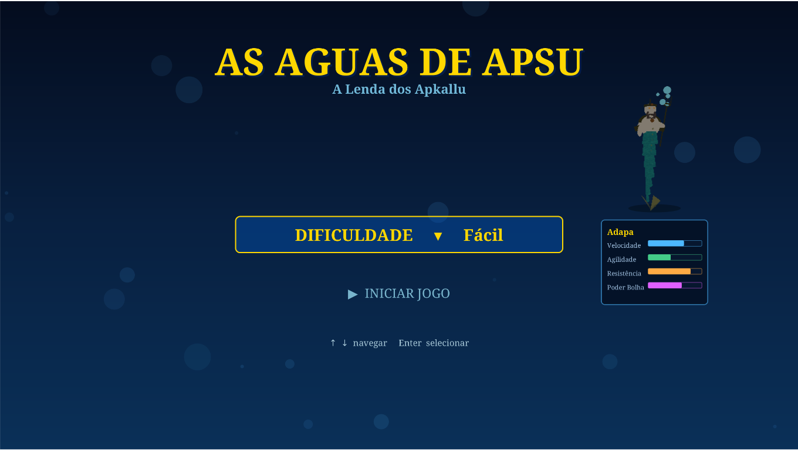
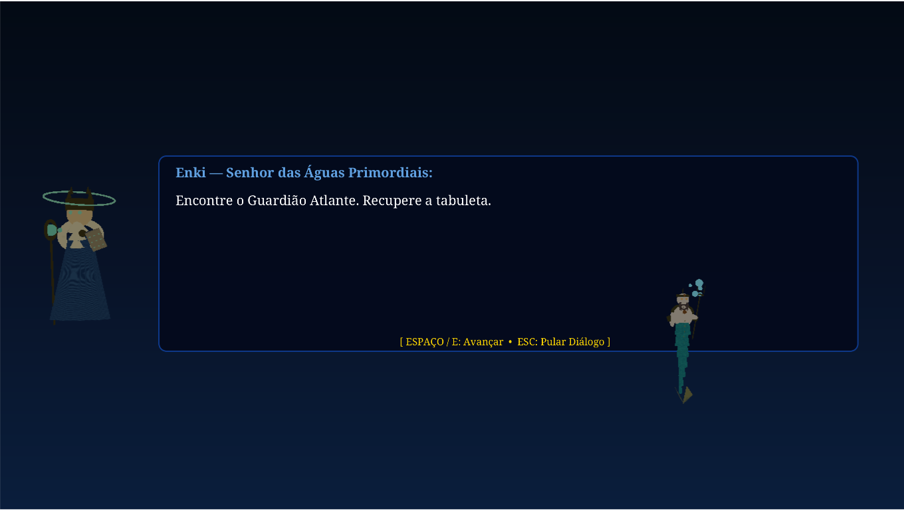
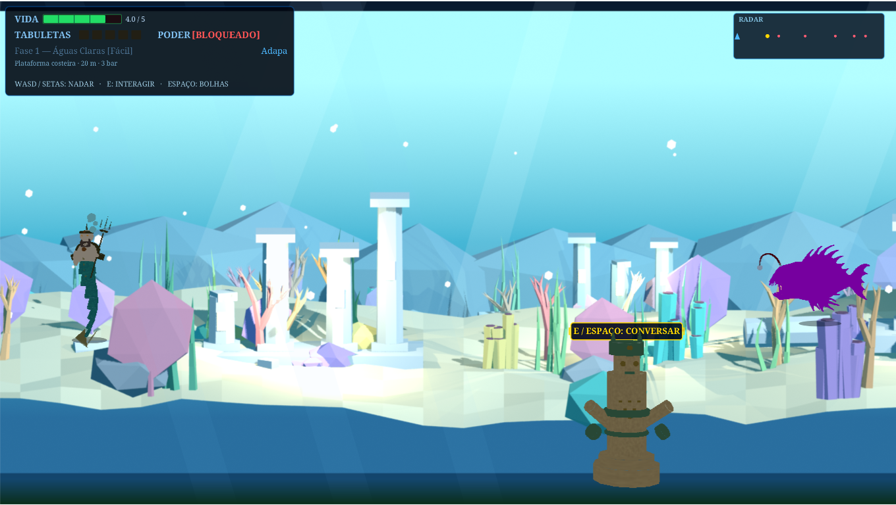
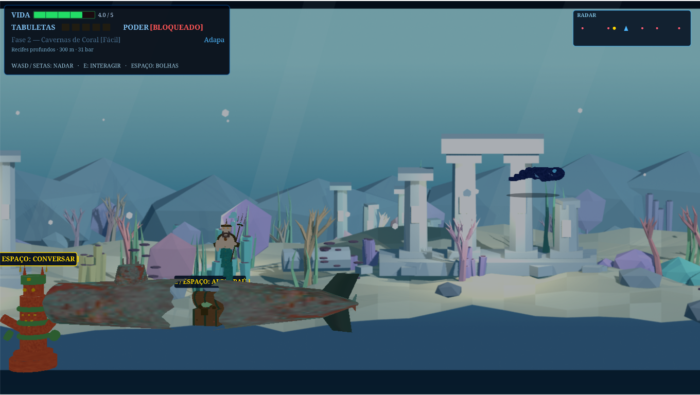
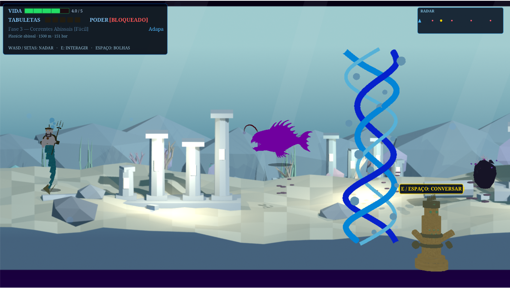
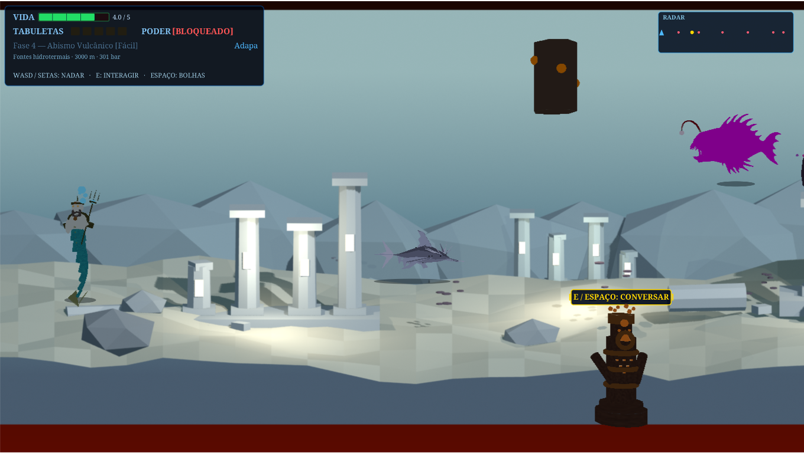
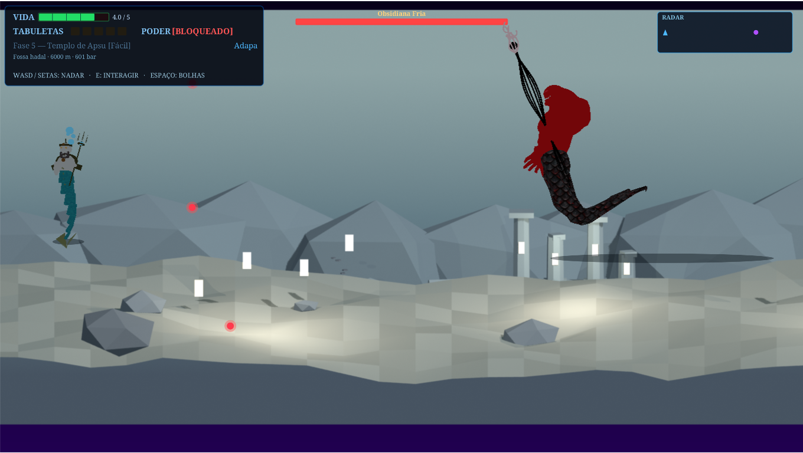

# As Águas de Apsu: A Lenda dos Apkallu

> **Documento central de produção.** Descreve o código e assets verificados, separa implementação de intenção e serve de checklist de sprint, modelagem, integração, áudio e QA. Atualize-o quando escopo ou estado mudar.

## Estado e como iniciar

Protótipo jogável Java 21/JavaFX 21, com câmera lateral e nado livre. Personagens e elementos de fase usam malhas OBJ/MTL 3D em tempo real em todos os perfis; o Canvas fica para HUD, indicadores e partículas. Os panoramas de fase são renders das cenas 3D em camadas com parallax, baseadas em `personagens/fases/fase1.blend`. Ter `.blend`, render, modelo ou WAV no repositório não significa que o asset tenha animação funcional ou esteja integrado.

Requisitos: Java 21, Maven e desktop com display gráfico.

```bash
make          # verifica o ambiente e inicia a aplicação JavaFX
make system-info # mostra o hardware, driver OpenGL e perfil automático
make test     # executa os testes
make coverage # executa verify e gera target/site/jacoco/index.html
```

`mvn javafx:run` inicia diretamente. `make docker-run` usa Docker e encaminhamento X11. Geração visual exige Blender; composição de áudio exige FFmpeg.

`make run` seleciona automaticamente `performance` (12+ threads, 16+ GB e GPU acelerada detectada), `balanced` ou `low`; todos mantêm malhas 3D no runtime. O perfil alto começa com efeitos completos; se o FPS cair abaixo de 50, reduz iluminação e partículas sem trocar personagens por imagens. Sobrescreva com `APSU_PROFILE=performance|balanced|low make run`. Em notebooks híbridos Linux/Mesa, `APSU_GPU=auto` respeita o renderer padrão da sessão, evitando cópias entre GPUs. Use `APSU_GPU=intel make run` ou `APSU_GPU=amd make run` para comparar/selecionar uma GPU manualmente. `make system-info` mostra o renderer OpenGL detectado. Use `APSU_PERF=1 make run` para registrar FPS, tempos de atualização/render e carregamento de cada OBJ. O perfil limita a heap Java a 3 GB/2 GB/1 GB respectivamente e respeita o limite de memória visível ao processo.

No Docker, `make docker-run` repassa `/dev/dri` quando disponível e deixa o Mesa escolher o renderer. Para Compose com GPU Intel/AMD, use `docker compose -f docker-compose.yml -f docker-compose.gpu.yml up`; sem dispositivo gráfico, Mesa pode usar renderização por software. `LIBGL_ALWAYS_SOFTWARE=1` força esse modo para diagnóstico.

Controles do runtime: no menu, ↑/↓ navegam, Enter abre a dificuldade ou inicia a partida, e Esc fecha o submenu; Adapa é sempre o herói principal. Durante o jogo, WASD/setas movem Adapa; Espaço dispara bolhas depois de desbloqueadas e M alterna tiro direto/múltiplo; E/Enter/Espaço/F são teclas contextuais de interação/diálogo conforme estado. A progressão exige tabuletas nas fases 1–4; o baú da fase 2 concede bolhas; a fase 5 é arena fixa contra Kullullû. Reinicie uma partida para validar desde o início.

### UX do menu e onboarding

O menu oferece duas ações: abrir o submenu de dificuldade (Fácil, Médio, Difícil) e iniciar. O submenu mantém o modo atual destacado e mostra os comandos de navegação/confirmação/retorno. Adapa usa sempre o modelo principal `01_adapa_heroi.blend`; saves antigos com uma variação são carregados com o protagonista principal.

Direção de UX para as fases: introduzir uma mecânica de cada vez em zonas seguras; reforçar comandos contextualmente perto da primeira interação; dar sinais visuais antes de dano (direção, tempo e área); manter objetivo, tabuletas e saída legíveis no HUD; confirmar coleta, dano, desbloqueio e transição com sinais visuais e sonoros coerentes. A implementação incremental deve começar por dicas contextuais e telegraphs de perigo, seguida por revisão de contraste, hierarquia e legibilidade em cada fase.

## Legenda de status

- **IMPLEMENTADO** — existe no código/runtime ou asset usado diretamente pelo runtime.
- **EM DESENVOLVIMENTO** — implementação parcial com integração/comportamento incompleto.
- **PLACEHOLDER** — substituto temporário, não aprovado para produção.
- **PENDENTE** — trabalho identificado ainda sem entrega integrada.
- **A DEFINIR** — falta decisão baseada em referência/escopo.
- **REFERÊNCIA** — material orientador, não necessariamente executado pelo jogo.

Não marcar como implementado só porque existe um arquivo: confirmar uso no runtime.

## Visão e linguagem de produção

Adapa, um Apkallu, atravessa cinco regiões submersas de profundidade crescente, conversa com guardiões, recupera tabuletas e enfrenta Kullullû no Templo de Apsu. O código usa níveis de 20 m a 6.000 m, pressão aproximada e menor flutuabilidade; é abstração de jogo, não simulação oceanográfica validada.

Direção acordada: toda a arte de jogo deve vir de modelos/cenas 3D Blender, usando malha ao vivo ou quadros renderizados do modelo para manter a fluidez. A proporção de cor 60/30/10 orienta a paleta de cada personagem e elemento móvel: cor dominante, cor de apoio e acento focal, escolhidos para contrastar com o cenário fixo daquela fase. Os cenários existentes são a referência visual e não devem ser recoloridos ou recompostos para acomodar os modelos. Nas fases profundas, reduzir luminância/saturação dos elementos móveis sem perder silhuetas, hazards, personagens ou HUD.

Nomenclatura de produção: fase + função + estado. Eventos de áudio devem ser semânticos e não conhecer nome/caminho de WAV, formato ou middleware.

## Experiência de gameplay — capturas por fase

Capturas do runtime JavaFX executado diretamente no host, sem Docker, salvas em [`gameplay/revisao-2026-10-31/`](gameplay/revisao-2026-10-31/). Cada fase foi aberta para revisão visual de composição, modelos 3D, HUD e escala; isso não representa uma rota completa jogada nem aceite de QA. As capturas ajudaram a localizar o deslocamento de profundidade do OBJ do naufrágio e a sobreposição do inimigo com o boss.

<table>
  <thead>
    <tr><th>Trecho</th><th>Capturas da sessão</th></tr>
  </thead>
  <tbody>
    <tr>
      <td><strong>Menu e prólogo</strong><br>Seleção inicial e chamado de Enki para a primeira região.</td>
      <td>
        
        
      </td>
    </tr>
    <tr>
      <td><strong>P1 — Águas Claras</strong><br>Primeiro encontro com o Guardião Atlante e apresentação da tabuleta e da próxima rota.</td>
      <td>
        
      </td>
    </tr>
    <tr>
      <td><strong>P2 — Cavernas de Coral</strong><br>Recife, cardume, naufrágio e aviso do Guardião do Coral Vivo sobre as correntes à frente.</td>
      <td>
        
      </td>
    </tr>
    <tr>
      <td><strong>P3 — Correntes Abissais</strong><br>Revisão de corrente, inimigos e leitura do cenário.</td>
      <td></td>
    </tr>
    <tr>
      <td><strong>P4 — Abismo Vulcânico</strong><br>Revisão de perigos, inimigos e silhuetas.</td>
      <td></td>
    </tr>
    <tr>
      <td><strong>P5 — Templo de Apsu</strong><br>Arena final com o boss, sem NPCs ou inimigos laterais.</td>
      <td></td>
    </tr>
  </tbody>
</table>

## Fases: estado e produção

Descrições de runtime conferidas em `GameContext.startP1`–`startP5` e métodos de update. O walkthrough visual maior está em [LevelsWalkthrough.md](personagens/fases/LevelsWalkthrough.md); é **REFERÊNCIA** para produção Blender, não comprova integração runtime.

### 1 — Águas Claras

- **Objetivo/progressão — IMPLEMENTADO:** apresentar nado, primeiro Guardião Atlante e tabuleta; sair para P2 após obter a tabuleta.
- **Conteúdo — IMPLEMENTADO:** peixe sombrio, enguia, medusa, caranguejo, gêiser tutorial, guardião, contato/diálogo, coleta e colisão.
- **Visual — IMPLEMENTADO/PENDENTE:** panorama `phase-1.png`, modelos/sprites existem. Escala, composição, planos e hierarquia 60/30/10 precisam de revisão. Ruínas/naufrágio do walkthrough são **REFERÊNCIA** até confirmar integração nesta fase.
- **Áudio:** perfil costeiro, tema e cues globais **IMPLEMENTADOS**; combate dedicado, stinger de entrada, transição temática, camadas e silêncio **PENDENTES/A DEFINIR**.
- **Fluxo observado:** início em x=100; desenvolvimento com inimigos e gêiser em x=2400; encontro do guardião/tabuleta; encerramento ao alcançar a saída com tabuleta. Atos narrativos formais: **A DEFINIR**.
- **Assets e camadas:** herói/guardião/inimigos e gêiser têm modelos/renders; manter panorama como background e definir midground/foreground da fase. Refinar textura/escala e ciclo de nado, inimigos, bolhas, hit e dano. Destrutíveis/decor específicos: **A DEFINIR**. Referência: panorama existente e capturas; composição final requer revisão.
- **Aceite:** concluir rota, coletar tabuleta, validar colisão/dano, gêiser, diálogo, áudio e transição única; revisar escala dos modelos.

### 2 — Cavernas de Coral

- **Objetivo/progressão — IMPLEMENTADO:** cruzar seis pares de corais, abrir baú em sala aberta para obter bolhas e coletar tabuleta.
- **Conteúdo — IMPLEMENTADO:** caranguejo, medusa, enguia, golfinho abissal, guardião de coral, corais com colisão, baú, naufrágio, gêiser.
- **Visual — PARCIAL:** panorama, recife/naufrágio/baú 3D existem e são posicionados no runtime; confirmar representação visual dos corais de colisão, escala e composição dos planos.
- **Áudio:** perfil deep reef e tema **IMPLEMENTADOS**; som próprio para baú, bolha, coral, fauna e transição **PENDENTE**.
- **Fluxo observado:** abertura com sala e primeiro inimigo; sequência de seis pares de coral; desenvolvimento com baú em x=1800 e guardião; gêiser em x=3200 e saída. Clímax narrativo além da coleta: **A DEFINIR**.
- **Assets e camadas:** produzir/refinar recifes, cardumes, naufrágio, baú, seis pares de coral e guardião; panorama como background; definir separação midground/foreground. Refinar nado, peixe/cardume, abertura de baú, bolhas e hazards; destrutíveis adicionais **A DEFINIR**. Referências: `.blend`, renders, PNGs e walkthrough.
- **Aceite:** rota sem aprisionamento; baú abre uma vez e libera ataque; tabuleta e transição funcionam; validar escalas e leitura dos hazards.

### 3 — Correntes Abissais

- **Objetivo/progressão — IMPLEMENTADO:** atravessar três correntes, uma zona de pressão, dois obstáculos móveis e dois gêiseres; obter tabuleta do Lamassu.
- **Conteúdo — IMPLEMENTADO:** peixe, enguia, medusa, caranguejo, golfinho; corrente afeta velocidade, pressão reduz flutuabilidade.
- **Visual — PARCIAL:** panorama e modelos de corrente, obstáculo e gêiser existem. Orientação/força legíveis, animação visível e escala relativa precisam de QA.
- **Áudio:** perfil abyssal **IMPLEMENTADO**; sinais de corrente, pressão, obstáculo e gêiser **PENDENTES**; camadas/silêncio **A DEFINIR**.
- **Fluxo observado:** abertura apresenta corrente em x=900; desenvolvimento alterna zona de pressão/obstáculo, corrente em x=2000 e corrente em x=3100; gêiseres antes do final; saída após tabuleta. Clímax/cena final: **A DEFINIR**.
- **Assets e camadas:** corrente, zonas de pressão, obstáculos móveis, gêiseres, inimigos e Lamassu possuem fontes 3D/renders; melhorar orientação visual, escala e sinais de perigo. Definir background/midground/foreground; animar corrente, obstáculos e nado; criar VFX/SFX dedicados. Destrutíveis: **A DEFINIR**. Referências: panorama e modelos/scripts existentes.
- **Aceite:** força compreensível, controle recuperável, sem tremor, colisão coerente e desempenho revisado.

### 4 — Abismo Vulcânico

- **Objetivo/progressão — IMPLEMENTADO:** atravessar lava, rochas, correntes ascendentes, pressão e gêiseres; coletar tabuleta do Oráculo.
- **Conteúdo — IMPLEMENTADO:** arraias, peixes, medusa, Leviatã Menor, polvo abissal; lava causa dano por contato.
- **Visual — PARCIAL:** panorama e modelos 3D de lava/gêiser/rocha/criaturas existem. Contraste do hazard, escala do Leviatã e sobreposição precisam de revisão.
- **Áudio:** perfil hidrotermal e faixa boss existem; identidade de lava, gêiser, Leviatã, polvo, combate e pausa antes do sub-boss **PENDENTE/A DEFINIR**.
- **Fluxo observado:** arraia introduz a ameaça; lava/rochas iniciam hazards; Leviatã aparece perto de x=2650; arraia/polvo e gêiseres levam à saída com tabuleta. Conclusão cinematográfica: **A DEFINIR**.
- **Assets e camadas:** refinar lava, rochas, gêiseres, arraias, Leviatã, polvo e Oráculo; melhorar escala e silhueta. Distinguir fundo vulcânico, hazards no midground e foreground sem cobrir herói. Faltam ciclos, telegraphs e VFX/SFX próprios; destrutíveis **A DEFINIR**. Referência: panorama, `.blend`, renders e walkthrough.
- **Aceite:** área de dano coincide com visual, forças não acumulam dano inesperado, criaturas/NPC não escondem Adapa, tabuleta permite transição.

### 5 — Templo Final de Apsu

- **Objetivo/progressão — IMPLEMENTADO:** arena fixa, diálogo com Enki, correntes/pressão e combate por fases contra Kullullû; lula vampira como inimigo.
- **Conteúdo — IMPLEMENTADO:** Kullullû principal, Enki, fases de combate e vitória. As variantes visuais não são selecionadas.
- **Visual — PARCIAL:** panorama, modelos de Kullullû/variantes, Enki e lula existem. Ruínas Atlantes marcam a descida entre fases; não há portal. Revisar tamanho, texturas, variantes, HUD e sobreposição.
- **Áudio:** troca de perfil para faixa boss e cue de mudança de fase **IMPLEMENTADOS**; intro, telegraphs, ataque, stagger, morte e stinger **PENDENTES**.
- **Fluxo observado:** entrada/diálogo de Enki → arena com lula/correntes/pressão → ciclos de padrão do boss → derrota/vitória. Transição para epílogo e encerramento pós-chefe: **A DEFINIR**.
- **Assets e camadas:** rever arena, Kullullû e variantes, Enki, lula vampira, correntes e ruínas. Ajustar escala/enquadramento e contraste do foreground para manter boss e Adapa visíveis. Animações visuais de dano/morte, telegraphs, VFX e SFX específicos pendentes; objetos destrutíveis e epílogo **A DEFINIR**. Referência: panorama, modelos, variantes e walkthrough.
- **Aceite:** partida nova limpa estado; boss só aparece em P5, recebe dano e pode ser derrotado; validar padrões, feedback, Enki, mix e performance.

### Matriz consolidada por fase

| Fase | Cenário/personagens | Inimigos e NPCs | Elementos/eventos | Áudio/música | Boss | QA e estado |
|---|---|---|---|---|---|---|
| P1 Águas Claras | Panorama, Adapa, Guardião Atlante; acabamento pendente | Peixe, enguia, medusa, caranguejo / guardião | Gêiser, tabuleta, diálogo, saída | Tema costeiro e cues globais; combate pendente | — | Revisar escala, colisão e transição |
| P2 Cavernas de Coral | Panorama, recife, naufrágio e baú | Caranguejo, medusa, enguia, golfinho / guardião coral | Corais, baú, bolhas, gêiser, tabuleta | Tema deep reef; cues de baú/fauna pendentes | — | Rota, desbloqueio, escala, hazards |
| P3 Correntes Abissais | Panorama, correntes e props 3D / Lamassu | Peixe, enguia, medusa, caranguejo, golfinho | Correntes, pressão, obstáculos, gêiseres | Tema abyssal; cues de perigo pendentes | — | Forças, leitura visual, frame-time |
| P4 Abismo Vulcânico | Panorama, lava, rochas, gêiser / Oráculo | Arraia, peixe, medusa, Leviatã, polvo | Hazards, corrente, pressão, tabuleta | Tema hidrotermal; identidade própria pendente | Leviatã é sub-boss/inimigo especial | Dano, escala, sobreposição |
| P5 Templo de Apsu | Arena/panorama, Enki e modelos 3D | Lula vampira / Enki | Arena, correntes, pressão, fases e vitória | Faixa hadal e boss existentes; stingers pendentes | Kullullû | Reinício, combate e conclusão |

## Pipeline de assets 3D

Scripts Blender em `personagens/scripts/`; fontes editáveis em `personagens/blends/` e `personagens/fases/`; renders de referência em `personagens/renders/`; recursos empacotados em `src/main/resources/`. As fases são renders de uma cena 3D real baseada em `fase1.blend`, com variações de ruínas e iluminação; personagens e elementos de gameplay são malhas OBJ/MTL no runtime; os PNGs de fases são renders Blender usados como panoramas de fundo. O jogo não executa Blender em runtime. Para uma mudança em um personagem/prop, use `make refresh-model MODEL=personagens/blends/.../arquivo.blend`; para o cenário use `make render-backgrounds`; para trilhas use `make convert-phase-music` (ou `make audio-assets` para também recalcular os perfis). `make assets` atualiza os recursos a partir das fontes existentes sem alterar `.blend`; `make assets-procedural` regenera os modelos de hazards/fauna gerados por script; `make assets-regenerate` regenera todas as fontes Blender e pode substituir `.blend` editados manualmente.

Fluxo de runtime: Blender → OBJ/MTL/texturas → malhas 3D carregadas em `Runtime3DLayer`. `make refresh-model MODEL=personagens/blends/.../arquivo.blend` atualiza um elemento; `make refresh-adapa-models` atualiza o herói e sua pose de ataque. `make render-sprites` permanece como alias compatível para exportar malhas; não gera PNG para gameplay. `make render-3d-previews` grava previews em `personagens/renders/previews/`.

Para cada modelo declarar nome estável, categoria/fase, escala/unidade, orientação frontal/eixo, origem, câmera e enquadramento, resolução/transparência, luz/material/paleta, textura relativa, estados/poses, ângulos, quadros/ciclos, export e destino no jogo. Ter timeline no Blender não significa animação no jogo: malhas OBJ são estáticas por estado; runtime aplica transformações simples. Rever materiais/texturas falhos, frente/lado, escala, pivôs, quantidade de polígonos/materiais, animações de nado/ataque/dano/morte, fundo transparente, resolução e cache. O nado deve evitar rotação excessiva (inclinação runtime limitada a ±20°).

### Matriz de inventário de assets

| Asset/categoria | Arquivos encontrados | Animação/VFX/SFX | Integração / estado |
|---|---|---|---|
| Adapa: base e ataque | .blend, OBJ/MTL/texturas; previews separados | Pose thrust em malha 3D; ciclo de nado runtime pendente | Modelo principal integrado; variantes não selecionáveis |
| Enki e guardiões | .blend, renders, sprites, modelos de NPC | Ciclo contínuo pendente | Diálogo implementado; confirmar modelo de cada fase |
| Inimigos comuns | modelos/renders/sprites de peixe, enguia, medusa, caranguejo | Sprites têm quadros em alguns casos; runtime usa malhas estáticas | Inimigos/colisões implementados |
| Criaturas especiais | arraia, Leviatã, golfinho, polvo, lula em assets 3D/renders | Ataques, hit, morte, VFX/SFX dedicados pendentes | Golfinho P2/P3, criaturas P4, lula P5 |
| Recife, cardume, naufrágio | .blend, render/sprite; recife e naufrágio posicionados em P2 | Animação contínua de cardume pendente | Integração parcial; escala/reuso em desenvolvimento |
| Ruínas e colunas | .blend/renders e panoramas | Marco visual de descida | Malha e sprite renderizado 3D |
| Corrente, pressão, obstáculos | Modelos 3D e renders | Indicação de força/telegraph pendente | Física implementada; leitura visual em desenvolvimento |
| Gêiser, lava, rocha | Modelos 3D gerados/exportados | Ciclo/telegraph/VFX específicos pendentes | Elementos no runtime |
| Panoramas de fase | PNG phase-1…phase-5 | Não são cenário 3D navegável nem layers parallax independentes | Implementados; revisão artística pendente |
| VFX bolha/hit/dano/coleta | Partículas genéricas no core | Catálogo/timing por evento pendente | Alguns bursts implementados |
| SFX e música | WAV fonte e WAV por perfil/profundidade | Catálogo completo e mix QA pendentes | Reprodução e troca de música implementadas |
| Plataforma, porta, mecanismo, checkpoint, pickups extra | Sem inventário funcional confirmado | A definir | Não assumir requisito/implementação |

Decompor cada fase em personagens (herói, NPC, inimigo, miniboss/boss), arquitetura (piso, parede, ruína, coluna, caminho, porta), natureza/ambiente, gameplay (hazard, pickup, tabuleta, baú, gatilho, checkpoint), visual (background, midground, foreground, luz, partículas, impacto, dano, destruição, transição) e áudio. Sem referência/ocorrência confirmada: **A DEFINIR**.

### Matriz resumida de produção por asset e fase

“Existe” significa arquivo encontrado; não substitui revisão de qualidade. “Parcial” indica fonte/render presente, mas estado/animação/integração incompletos.

| Asset | Categoria | Fase | Existe? | Modelo 3D | Preview renderizado | Sprite PNG runtime | Animação | VFX | SFX | Integração / estado |
|---|---|---|---|---|---|---|---|---|---|---|
| Adapa base | Herói | P1–P5 | Sim | OBJ em runtime | Preview opcional | Não usado no gameplay | Malha vertical; pose thrust 3D ao disparar | Partículas genéricas | Ataque/dano genéricos | Modelo 3D animado no runtime |
| Guardião Atlante | NPC | P1 | Sim | Sim | Sim, preview | Sim | Quadros existem; ciclo runtime não confirmado | Não específico | Diálogo genérico | Encontro integrado; revisar escala |
| Coral, Lamassu, Oráculo | NPC | P2–P4 | Sim | Sim | Sim, preview | Sim | Ciclo runtime pendente | Não específico | Diálogo genérico | Encontro por fase; QA visual |
| Enki | NPC narrativo | Intro/P5 | Sim, variantes | Sim | Sim, preview | Sim | Estático no runtime | Não específico | Avanço de diálogo | Modelo visível; refinar estados |
| Peixe, enguia, medusa, caranguejo | Inimigos comuns | P1–P3 | Sim | Sim, runtime | Preview opcional | Não usado no gameplay | Malhas estáticas; animação pendente | Genérico | Acerto/derrota genéricos | Gameplay integrado |
| Golfinho abissal | Inimigo especial | P2–P3 | Sim | Sim | Sim | Sim | Runtime pendente | Genérico | Genérico | Spawn/colisão implementados |
| Arraia, Leviatã, polvo | Criaturas/sub-boss | P4 | Sim | Sim | Sim | Sim | Estados runtime incompletos | Genérico | Genérico | Gameplay existe; telegraph/escala pendentes |
| Lula vampira e Kullullû | Inimigo e boss | P5 | Sim, variantes do boss | Sim | Sim | Sim | Fases do boss são lógicas; visual parcial | Genérico | Hit/fase/vitória | Combate integrado; cues/estados dedicados pendentes |
| Recife, cardume, naufrágio, baú | Ambiente/interativo | P2 | Sim | Sim | Sim | Sim | Quadros existem; loop runtime não confirmado | Pickup genérico | Pickup genérico | Recife/navio/baú posicionados; baú interativo |
| Correntes, pressão, obstáculos | Gameplay/ambiente | P3–P5 | Sim | Sim | Sim | Parcial | Oscilação/física lógica; visual parcial | Indicadores pendentes | Cues ambientais pendentes | Forças/colisões integradas |
| Gêiser, lava, rocha vulcânica | Hazards | P1–P4 | Sim | Sim | Sim | Sim | Ciclo/telegraph visual pendente | Genérico/parcial | Cues próprios pendentes | Dano/impulso conforme tipo |
| Panoramas e marco de descida | Fundo/transição | P1–P5 | Sim | `fase1.blend` e ruínas Atlantes | PNGs renderizados de cenas 3D | Ruínas/colunas como sprite ou malha 3D | Sinal visual discreto de fase liberada | Não específico | Transição pendente | Sem portal; panorama integrado, não é geometria navegável |
| Tabuleta e feedback de coleta | Gameplay/VFX | P1–P4 | Parcial | A definir por objeto | A definir | Assets de jogo | Não aplicável | Burst genérico | Pickup genérico | Coleta/progressão integradas; variedade pendente |
| Música, ambiência e SFX | Áudio | P1–P5 | Sim, fontes e WAVs | N/A | N/A | N/A | Loops por faixa; stems pendentes | N/A | Cues existentes | Troca de perfil integrada; catálogo/mix QA pendentes |
| Portas, plataformas, mecanismos, checkpoints | Gameplay | A DEFINIR | Sem inventário funcional confirmado | A definir | A definir | A definir | A definir | A definir | A definir | Não presumir escopo/implementação |

## Eventos e áudio

### Contrato semântico

`GameEvent`/ `EventBus` comunicam; `AudioEventSubscriber` conecta ao `AudioPort`/`AudioManager`; `JavaFxAudioOutput` resolve cue semântico para arquivos e ganho. `AudioCue` contém nomes de ação como `ATTACK`, `PICKUP`, `HERO_DAMAGED`, sem nome de arquivo. Trocar WAV fica no adaptador e não pede alteração da lógica de gameplay. Usar enum Java `UPPER_SNAKE_CASE`, nomeando ação/resultado e não instrumento, processamento ou nome do arquivo.

Efeitos curtos usam um único `AudioClip` PCM compartilhado por cue e não sobrepõem uma reprodução do mesmo efeito; a profundidade ajusta o volume. Isso evita carregar cinco cópias de cada efeito e reduz a criação de players concorrentes. Trilhas de fase e boss usam `MediaPlayer` em loop com WAV PCM 16-bit/44,1 kHz; o player espera a faixa ficar pronta, usa volume-base de 55% (atenuado pela profundidade) e tenta a faixa original se a versão gerada estiver ausente ou falhar. Falhas de inicialização/reprodução são registradas no console como `[AUDIO]`.

Tipos declarados em `GameEvent.Type`: `SOUND_REQUESTED`, `HERO_DAMAGED`, `HERO_SHOT`, `ENEMY_DEFEATED`, `TABLET_COLLECTED`, `BOSS_DEFEATED`, `BOSS_PHASE_CHANGED`, `OCEAN_DEPTH_CHANGED`, `BOSS_MUSIC_CHANGED`. A integração atualmente publicada/consumida no áudio inclui pedido de cue, mudança de profundidade, modo de faixa do boss e mudança de fase do boss. Declarar um enum sem produtor/consumidor não torna o comportamento implementado. Eventos adicionais só entram com produtor, payload, frequência, consumidor e teste definidos. O core não deve conhecer caminho/arquivo WAV nem middleware.

### Matriz de eventos de áudio

| Evento semântico | Momento/intenção sonora | Estado de core |
|---|---|---|
| `MENU_NAVIGATE` | Move seleção ou altera opção do menu | Implementado; fonte sintetizada pelo FFmpeg, substituível |
| `MENU_CONFIRM` | Confirma escolha, curto e discreto | Implementado; fonte sintetizada pelo FFmpeg, substituível |
| `DIALOGUE_ADVANCE` | Avançar fala sem mascarar texto/voz | Implementado |
| `PICKUP` | Recompensa clara para baú/tabuleta/item | Implementado; diferenciar tipos pendente |
| `ATTACK` | Disparo de bolha, resposta imediata | Implementado |
| `ENEMY_DAMAGED`, `ENEMY_DEFEATED` | Impacto seguido de derrota em inimigo de vida única | Ambos publicados no acerto fatal; impacto usa fonte sintetizada pelo FFmpeg, substituível |
| `HERO_DAMAGED` | Comunicar dano com prioridade | Implementado |
| `BOSS_DAMAGED`, `BOSS_PHASE`, `VICTORY` | Impacto, nova fase e resolução | Implementado parcialmente; telegraph/morte dedicados pendentes |
| `SWIM_LOOP`, `JUMP`, `LAND`, `INTERACT` | Movimento/contexto; nado é mecânica, não presumir pulo | A definir/pendente |
| `ENEMY_SPAWN`, `ENEMY_DETECTS_PLAYER`, `ENEMY_ATTACK`, `ENEMY_SPECIAL_ATTACK` | Presença, ameaça, janela de reação | Pendente |
| `GUARDIAN_DIALOGUE_STARTED/ENDED` | Entrada/saída e identidade de NPC | Pendente; avanço de fala existe |
| `CHEST_OPENED`, `TABLET_COLLECTED`, `CHECKPOINT_ACTIVATED` | Feedback específico de mundo | Pickup genérico existe; eventos dedicados pendentes; checkpoint a definir |
| `CURRENT_ENTERED/EXITED`, `PRESSURE_ENTERED`, `GEYSER_WARNING/ERUPTED`, `LAVA_CONTACT` | Perigo ambiental antes/durante/depois | Física/dano existem em parte; cues dedicados pendentes |
| `PHASE_STARTED/COMPLETED`, `LEVEL_TRANSITION` | Música, ambiência e transição sincronizadas | Troca de perfil ao iniciar; eventos dedicados pendentes |
| `BOSS_INTRO/ATTACK/STAGGER/DEFEATED` | Identidade, telegraph e resolução do boss | Modo musical/fase implementados; cues dedicados pendentes |

São sugestões de catálogo; só adicionar se a mecânica existir. Para cada evento aprovado, registrar produtor, payload, instante, cooldown/repetição, prioridade, posição espacial, consumidor de áudio/VFX/UI e teste. Um evento pode alimentar vários consumidores.

### Música e composição por fase

Intenção comum: mistério, descoberta e despertar de poder nas fases iniciais; densidade, menos agudos e pressão sonora progressiva no fundo; tensão clara no boss. Feedback de gameplay deve ser curto/priorizado; ambiência sustenta espaço sem competir. Música acompanha estados/eventos, não é somente arquivo fixo da fase. Hoje há troca de perfil de profundidade e faixa boss, mas não sistema geral de stems/camadas dinâmicas orientadas a todos os estados.

| Fase | Principal/exploração | Combate/boss | Transições, stingers, loops, variações, silêncio, ambiência | Realidade |
|---|---|---|---|---|
| P1 coastal | Tema existente; descoberta e água clara | Combate próprio a definir; sem boss | Stinger de tabuleta/transição pendente; ambiência e silêncio a definir | Tema do perfil existe |
| P2 deep reef | Exploração de recife/cavernas | Mudança por densidade de ameaça a definir | Baú, cardume, coral, camadas biológicas pendentes | Tema filtrado existe |
| P3 abyssal plain | Correntes, espaço rarefeito | Intensificar corrente/perigo a definir | Entrada/saída, rumble, silêncio pendentes | Perfil filtrado existe; dinâmica parcial |
| P4 hydrothermal vent | Tensão geológica com respiro | Leviatã/combate a definir | Lava/gêiser, pausa pré-sub-boss pendentes | Tema e boss track existem |
| P5 hadal trench | Exploração do templo a definir | Faixa boss dedicada selecionável | Intro, telegraphs, mudança, vitória e retorno pendentes | Troca de modo e faixa boss implementadas |

Os quatro arquivos `fase1.mpeg`–`fase4.mpeg` são convertidos para WAV PCM 16-bit/44,1 kHz estéreo em `audio/generated/<perfil>/faseN.wav` e usados na fase correspondente. A conversão preserva a qualidade já decodificada do MPEG, mas não recupera informação perdida na compressão original. `apsu-theme.wav` segue como fallback da faixa costeira; as faixas boss e os efeitos-fonte permanecem. `tools/audio/render_audio_assets.py` gera offline os perfis de música; os efeitos curtos são reproduzidos uma vez por cue, sem variantes de perfil no runtime. Fontes, créditos e licenças em [docs/audio/SOURCES.md](docs/audio/SOURCES.md). Registre créditos ao adicionar áudio.

## Sprint (seis integrantes)

Uma pessoa lidera áudio e QA; cinco integrantes de arte/produção recebem individualmente uma fase no sprint. É divisão inicial, não impede revisão cruzada.

1. **Preparação:** selecionar fase, ler este README, walkthrough e referências; registrar objetivo, limites, fontes e aceite. Bloqueios são decididos; lacunas ficam **A DEFINIR**.
2. **Produção individual:** cada integrante faz assets/componentes atribuídos, registra escala, orientação, estados, destino e dependências. Áudio prepara mapa de eventos/música; QA prepara casos reproduzíveis.
3. **Integração:** incorporar malhas/renders, colisões, eventos e recursos no classpath/runtime. Preview Blender não vale como integração.
4. **Revisão coletiva:** jogar a fase inteira e rever gameplay, visual, câmera, composição, assets, escala, colisões, animações, eventos, áudio, performance, coerência e QA; guardar evidências.
5. **Consolidação:** registrar problemas/severidade, correções, assets faltantes, decisões, eventos, necessidades de áudio, mudanças de gameplay/visual e responsáveis; atualizar matrizes.
6. **Aceite:** rota completa repetível sem bloqueador; progressão correta; atores/NPCs corretos; escala, colisões e hazards legíveis; assets carregam; eventos/áudio/transições revisados; performance dentro do orçamento acordado; nenhum bug crítico/alto sem decisão. Limite numérico de FPS/frame-time e dispositivo de referência **A DEFINIR**.

## QA por fase

Marcar aprovado/reprovado/não aplicável; anexar fase/dificuldade, passos, estado inicial, esperado/observado, build/commit e evidência. Testar partida nova e, quando disponível, dificuldade normal/difícil.

- [ ] Execução por `make`/JavaFX, início, pausa/retorno e saída sem erro fatal ou asset ausente.
- [ ] Controles: nado em quatro direções, ataque, interação, diálogo e coleta.
- [ ] Colisões: limites, projéteis, inimigos, pickups, hazards, corrente, pressão, dano e invulnerabilidade.
- [ ] Câmera: scroll, arena fixa, HUD e composição sem cobrir personagem/evento.
- [ ] Progressão: tabuletas, baú, desbloqueio, transição e vitória.
- [ ] Checkpoints/saves: aplicar apenas onde existe; testar save/load e recomeço sem boss/entidade residual.
- [ ] Inimigos/boss: fase correta, escala, textura, orientação, colisão, dano, estados, telegraph, derrota; boss apenas na P5.
- [ ] Eventos/animações: disparo correto e uma vez; nado estável; mudança de estado sem salto de posição/escala.
- [ ] Sprites/modelos: frente, silhueta, material/textura, alpha, resolução, perspectiva, escala e posição.
- [ ] VFX: ataque, impacto, dano, coleta, hazard e transição legíveis sem cobrir HUD/atores.
- [ ] Áudio: cue correto, volume, clipping, repetição, loop, perfil, modo boss, retorno e independência de nome de WAV.
- [ ] Música/transições: explorar, combater, boss, mudança de fase, vitória e partida repetida; procurar cortes/sobreposição.
- [ ] Bugs/assets faltantes: passos mínimos, esperado/observado, severidade, captura/log e responsável.
- [ ] Performance: carregamento, frame pacing, CPU/GPU/GC em cena leve e cheia; comparar com orçamento aprovado.
- [ ] Fase completa concluída e repetida após reset; checklist/status atualizado.

## Referências existentes e decisões

| Referência | Preservar / representa | Derivar | Limites |
|---|---|---|---|
| [PDF gráfico](docs/diagrams/%5BGr%C3%A1fica%5D%20Game%20-%20%C3%81guas%20de%20Apsu.pdf) e ZIP próximo | Material gráfico já existente; consultar fonte completa | Inventário de telas/fases/assets após revisão da equipe | Não substituir por interpretação; lacunas ficam A DEFINIR |
| [LevelsWalkthrough.md](personagens/fases/LevelsWalkthrough.md) | Proposta de cena Atlantis, zonas, câmeras, animações | Modelos/tomadas de Blender | Não prova gameplay/runtime |
| `personagens/images/`, `personagens/fases/gameplay/` | Referências visuais e capturas existentes | Silhueta, paleta, comparação | Capturas podem ser build anterior |
| `personagens/scripts/`, `tools/assets/` | Fontes procedurais, preservar | .blend, OBJ/MTL, previews, panoramas | Escala, material e integração devem ser validados |
| [SOURCES.md](docs/audio/SOURCES.md) | Fontes, autores, licenças registradas | Camadas de profundidade/boss via FFmpeg | Incluir origem/licença de todo asset novo |
| `backgrounds/phase-1.png…phase-5.png` | Fundos empacotados no runtime | Composição e contraste de fase | Rasterizados, não fase completa em 3D |

Preservar originais. Mudanças de paleta, personagem, história, câmera e conteúdo são decisão coletiva registrada no sprint. Sem evidência no código ou referência, usar **A DEFINIR**.

## Arquitetura e manutenção

- Entrada: `br.apsu.Launcher` → `ApsuGameMain`; protótipo principal JavaFX/Canvas.
- Gameplay/montagem: `GameContext`; física/estado em `model`; loop/câmera em `core`.
- Render: `RenderEngine`, `SpriteManager`, `Runtime3DLayer`, `ObjModelLoader`.
- Eventos: `EventBus`/`GameEvent`; áudio/VFX como consumidores, sem colisão dentro do output.
- Áudio: `AudioCue` semântico; `AudioManager` controla perfil; `JavaFxAudioOutput` mapeia WAV/ganhos; `AudioEventSubscriber` conecta barramento. FFmpeg offline.
- Automação: Makefile, `tools/assets/`, `tools/audio/`, fontes em `personagens/`.

Ao adicionar evento, defina semântica antes do som. Ao trocar WAV, altere recursos/mapeamento no adaptador e créditos, sem modificar gameplay. Ao mudar fase, atualize matriz de assets, áudio, checklist e QA.

## Testes e validação deste estado

`make test`/`mvn test` rodam JUnit; `make coverage`/`mvn verify` geram `target/site/jacoco/index.html`. Cobertura mede execução de código, não qualidade visual, equilíbrio ou aceite de áudio. Evitar percentuais estáticos: usar relatório do build corrente.

**Validação desta atualização (28/09/2026):** `mvn verify -q` concluiu com sucesso, 66 testes, sem falhas/erros, e gerou o relatório JaCoCo. `mvn javafx:run -q` iniciou e continua aberto na sessão gráfica para validação manual. A inicialização comprova o boot da aplicação, mas não substitui jogar cada fase usando a checklist acima. Foram emitidos avisos JavaFX `SCENE3D` no ambiente de execução dos testes; confirmar renderização 3D em máquina com aceleração gráfica ao fazer QA visual.

**Ajuste de áudio (28/09/2026):** `mvn -q -DskipTests compile` passou; ao iniciar o jogo, o log confirmou a faixa costeira pronta a 55%. A sessão PipeWire apresentou o fluxo Java sem mute e sem cork. A audição subjetiva/volume do equipamento deve ser confirmada por quem está jogando.

**Melhorias de desempenho, áudio e QA (28/09/2026):** o runtime agora carrega um OBJ por modelo e compartilha malhas/materiais entre instâncias; vértices e normais repetidos são deduplicados, e inimigos/NPCs fora da câmera não são instanciados. Removidos adornos Canvas repetidos na P2 e caminhos de desenho ambiental que eram vazios. A quadtree é atualizada uma vez antes dos projéteis, sem reconstrução duplicada. `make audio-assets` gera e processa fontes provisórias substituíveis para navegação/confirmação do menu e impacto em inimigo; os eventos continuam independentes dos arquivos. `mvn -q verify` passou com 68 testes e relatório JaCoCo; `mvn javafx:run -q` está aberto e confirmou a trilha costeira ativa. O ambiente de teste ainda avisa que não oferece suporte a `SCENE3D`; a renderização deve ser conferida na sessão gráfica. **PENDENTE:** fontes finais desses três SFX, sons de movimento/ambiente/transições, e um modelo de coral de colisão dedicado e leve (o modelo atual de recife mistura cardume e vários materiais). O orçamento de FPS e a validação de cada fase continuam a definir/pendentes.

**Otimização adicional de runtime (28/09/2026):** os quatro OBJ de ataque do herói (1–2 MB cada) não são mais carregados sincronamente no primeiro golpe; o modelo 3D da skin permanece e usa inclinação breve no impulso, com arco/bolha de feedback. Gradientes e cores imutáveis do Canvas são cacheados; partículas compartilham paletas de alpha e são atualizadas por compactação da lista, evitando iterador e objetos `Color` por partícula a cada frame. A quadtree só é limpa/preenchida quando existe projétil do herói; sombras de inimigos fora da tela são omitidas; IDs de ator estáveis removem nós 3D antigos ao substituir modelo. **A validar em hardware gráfico:** comparar FPS/frame time antes/depois com cena cheia e confirmar a leitura visual do golpe sem os OBJ de ataque.

Registrar build/commit, comandos, resultado, ambiente gráfico e fases efetivamente jogadas nas próximas validações. **A DEFINIR:** orçamento numérico de performance, hardware de referência, critério formal de mix e arte final.

**Verificação da revisão (31/10/2026):** `mvn verify` passou localmente com 80 testes, sem falhas/erros/skips. O workflow de release publicou a tag `v20261031-111014` e o JAR executável com a versão timestampada. P2 não replica o OBJ de recife/cardume em cada barreira; o naufrágio usa a malha 3D, com eixo de profundidade centrado e um único baú interativo no meio da ruptura do casco. O golfinho abissal aparece na P4; a arena P5 não instancia Enki, inimigos laterais ou correntes, e posiciona o boss ampliado à direita, voltado para a esquerda e dentro da tela. Personagens e props são ajustados à paleta de cada fase pela referência 60/30/10; os cenários permanecem intactos. As capturas por fase em `gameplay/revisao-2026-10-31/` documentam a revisão visual; ainda é necessário medir frame pacing em GPU/dispositivo de referência.

## Documentação relacionada

- [AGENTS.md](AGENTS.md) — regras locais.
- [CONTRIBUTING.md](CONTRIBUTING.md) — workflow/responsabilidades.
- [DEVELOPMENT.md](DEVELOPMENT.md) — setup/build/test/run.
- [ARCHITECTURE.md](ARCHITECTURE.md) — arquitetura técnica.
- [SOURCES.md](docs/audio/SOURCES.md) — fontes e créditos de áudio.
- [Diagrama SVG](docs/diagrams/architecture_diagram.svg) — conferir contra o código ao atualizar.

Para preservar uma cópia identificável do código-fonte, a release anexa um ZIP versionado e seu resumo SHA-512. O INPI solicita o hash da documentação técnica (código-fonte), que pode ser um conjunto compactado; para um pedido futuro, deve-se guardar exatamente o arquivo correspondente ao hash. Consulte o [guia oficial do INPI](https://www.gov.br/inpi/pt-br/servicos/programas-de-computador/guia-basico).

## Aprendizados e desafios

- O tempo dentro de `GameContext.update` e da chamada `RenderEngine.render` não representa o custo total do frame. A cadência do JavaFX/Prism, a composição da `SubScene` 3D, o driver e a mídia também precisam entrar na medição; manter FPS, p50/p95/máximo de pulse e gravações JFR juntos evita otimizar o subsistema errado.
- No host de desenvolvimento, 99 segundos de gravação registraram 8.617 criações e 8.602 encerramentos de threads `Thread-*` nativas; depois de compartilhar e limitar os efeitos, uma amostra de gameplay com áudio ligado registrou 3 criações em 20 segundos. Isso confirmou custo alto na reprodução de efeitos. O teste sem áudio ainda teve picos de pulse, então a composição/driver continua sob investigação.
- A árvore espacial de inimigos também atende colisões de contato; preenchê-la somente quando existe projétil do herói fazia o dano depender de disparar. Ela agora é reconstruída uma vez por atualização e há um teste que cobre contato sem bolhas.
- Malhas grandes devem ser carregadas fora do thread de render e instanciadas com dimensões-alvo explícitas. O centro da arena P5 usa coordenadas de tela; misturar o offset de câmera das fases com a hitbox e a malha do boss o desloca para fora de posição.
- O OBJ transforma o eixo Y do Blender em profundidade da câmera. Centralizar apenas X e altura deixa cada objeto com parallax diferente conforme sua origem no Blender; centralizar os três eixos mantém naufrágio, boss e hitbox no mesmo referencial de tela.
- `Ke` no MTL é cor emissiva, não um segundo uso do mapa diffuse. Aplicar o diffuse inteiro como emissão retira o contraste de luz que dá leitura às texturas. O runtime agora mantém o diffuse ligado à iluminação e reserva mapas emissivos separados para quando o pipeline os exportar.
- Reposicionar um boss maior exige rever inimigos e zonas visuais da arena. A captura P5 ajudou a remover os elementos laterais que disputavam atenção; a revisão das texturas do próprio modelo ainda deve preservar contraste e leitura contra o panorama fixo.
- Um OBJ ambiental completo com cardume não é uma peça de coral: instanciá-lo em cada obstáculo replica a cena toda e espalha elementos. Use uma composição completa uma vez ou gere um asset modular antes de distribuir peças pelo mapa.
- Feedback visual não deve simular dano com piscadas contínuas ou tremor intenso: a invulnerabilidade é comunicada no HUD, enquanto o shake global e a oscilação ociosa do personagem ficam sutis. Conferir isso em captura de tela e jogando continua necessário.
- Testes unitários validam regras e carregamento de malha, mas não substituem QA visual em GPU acelerada. Registrar fase, dificuldade, modelo visível, renderer e amostra de frame-time junto com cada captura torna o relato reproduzível.

## Créditos

Créditos técnicos conforme os responsáveis registrados em [`CODEOWNERS`](CODEOWNERS): [@rafael](https://github.com/rafael) — núcleo do jogo, gameplay, gráficos, ferramentas, build e documentação; [@erik](https://github.com/erik) — áudio; [@wagner](https://github.com/wagner) — modelos e pipeline 3D em `personagens/`; [@marcos](https://github.com/marcos) — assets em `assets/`. As fontes, licenças e créditos específicos das músicas e efeitos estão em [docs/audio/SOURCES.md](docs/audio/SOURCES.md).
